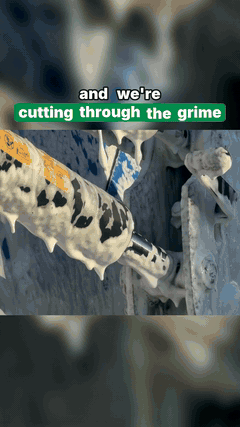
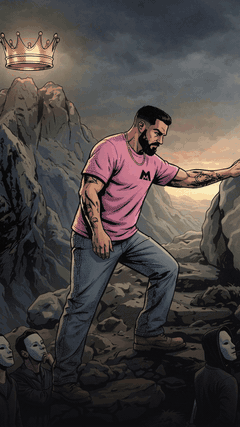

# Invokard Studio

Creado por **Antonio José Bergoños (Octonove)**. El código y la documentación se publican con licencia MIT; conserva el aviso de autoría al reutilizarlos. Los medios de los ejemplos tienen derechos separados: [MEDIA_LICENSE.md](MEDIA_LICENSE.md).

Si te ahorra una sesión de montaje, [invítame a una Paulaner](https://www.paypal.com/donate/?business=stradoxx%40gmail.com&no_recurring=0&currency_code=EUR&item_name=Support%20Invokard%20Studio). El motor de reels funciona igual de bien sin cerveza.

**Reels que parecen editados, hechos por tu agente de programación.** Una skill para Claude Code, Codex, Antigravity,
Gemini CLI y Cursor, y un motor en Python que compone cada fotograma: subtítulos palabra a palabra con la palabra
clave resaltada, titulares y píldoras animadas, gráficas, cortinillas de antes y después, cortes a tiempo con la
música, tarjetas de cierre y una mezcla de audio bien hecha. Trae imágenes y clips de Magnific (o de cualquier otro
proveedor), el metraje del propio cliente, o solo una canción y su portada.

*Read this in English: [README.md](README.md).*

| Metraje del cliente, cortado al ritmo | Ilustraciones + voz + gráfica | Una canción y su portada |
|:---:|:---:|:---:|
|  |  |  |
| [Schippers New Zealand](examples/schippers/) · 31 s · 34 clips de móvil, sin locución, el guion del cliente en pantalla, una cortinilla sobre el logo, todo sobre una rejilla de 115 BPM. Cero créditos en vídeo. | [Ekilib](examples/ekilib/) · 45 s · nueve frases de locución, trece ilustraciones al estilo del cliente, una tarjeta de glucosa animada, una lista numerada, un morph. | [Maemuki](examples/maemuki/) · 20 s · el estribillo transcrito en local y ajustado a la letra; una panorámica sobre la portada. Cero créditos. |

Un cuarto conjunto, tres reels de prompts para [Simplifica con IA](examples/simplificaconia/), enseña el cierre
«Comenta PALABRA» y las píldoras de sección (hechos con la versión anterior del motor; no incluyen script). De los
otros tres, el `reel.py` que los produjo va dentro de la skill (`skills/invokard-studio/assets/examples/`), para que
el agente lo lea antes de escribir el suyo: ese fichero *es* el montaje.

## Cómo funciona

```
   guion ──▶ voz (un fichero por frase) ──▶ subtítulos palabra a palabra ──▶ cada corte = el tiempo de una palabra
   imágenes (IA, con referencia de estilo) ──▶ previsualizar el montaje en fijo ──▶ clips solo para los planos con movimiento
   clips del cliente ──▶ hojas de contactos ──▶ extraer tramos ──▶ rejilla de beats ──▶ cortinilla ──▶ tarjeta en el golpe final
   canción / locución grabada ──▶ align.py (faster-whisper) ──▶ subtítulos desde palabras con tiempo
                                        │
                              reel.py  ─┴─▶  reelkit: fotogramas con Pillow ──▶ ffmpeg h264 + mezcla ──▶ out/reel.mp4 + portada
```

El agente escribe `reel.py` (entre 60 y 150 líneas que describen planos, capas, voz y efectos), lo previsualiza como
hoja de contactos, lo corrige y lo renderiza. La skill (`skills/invokard-studio/SKILL.md`) es el método: qué generar y
en qué orden, cómo medir los tiempos, qué comprobar, qué cuesta cada cosa y qué no hacer. Sale de trabajo entregado a
clientes, no de una demo. Los reels son 9:16 por defecto; el mismo motor renderiza 16:9 y 1:1
([formatos](#formatos-916-169-11)).

## Instalar

Necesitas **Python 3.10 o posterior** y **ffmpeg** (trae ffprobe) en el PATH.

| | ffmpeg | Python |
|---|---|---|
| Windows | `winget install Gyan.FFmpeg` y abre una terminal nueva | python.org o `winget install Python.Python.3.13` |
| macOS | `brew install ffmpeg` | `brew install python` |
| Linux | `sudo apt install ffmpeg` (o el paquete de tu distribución) | suele venir instalado |

```bash
git clone https://github.com/Octonove/invokard-studio.git
cd invokard-studio
python -m venv .venv                     # un entorno propio: Ubuntu 23.04+, Debian 12 y Homebrew no dejan instalar con pip global
source .venv/bin/activate                # Windows: .venv\Scripts\activate
python -m pip install -r requirements.txt
python install.py doctor                 # ffmpeg, paquetes, fuentes, claves (solo el nombre), agentes: cada línea debe salir ok o --
python install.py                        # instala la skill en Claude Code / Codex / Antigravity / Gemini CLI / Cursor / Windsurf
```

| Agente | Dónde queda la skill | Cómo se invoca |
|---|---|---|
| Claude Code | `~/.claude/skills/invokard-studio` | pide un reel; o `/invokard-studio` |
| Codex CLI / app | `~/.codex/skills/invokard-studio` y `~/.agents/skills/` | `$invokard-studio hazme un reel de 30 s con estos clips` |
| Antigravity | `~/.gemini/config/skills/invokard-studio` | `/invokard-studio` |
| Gemini CLI | `~/.gemini/skills/invokard-studio` | `/invokard-studio` o pídelo |
| Cursor | `~/.cursor/skills/invokard-studio` | pídelo; Cursor lee también las carpetas de Claude y Codex |
| Windsurf | `~/.codeium/windsurf/skills/invokard-studio` | pídelo |

`python install.py --project .` la instala en el proyecto actual (`.agents/skills`, `.claude/skills`…) para que un
equipo la comparta por git. `--link` usa un enlace simbólico o junction: lo que edites en este repo se aplica al
momento. `--agents codex,cursor` limita los destinos. `python install.py uninstall` quita lo instalado.

Opcional: `python -m pip install -r requirements-align.txt` (faster-whisper) para subtítulos a partir de una locución
grabada o una canción.

## Tu primer reel en 5 minutos

Sin cuenta, sin clave y sin descargas: [`examples/first-reel`](examples/first-reel/) dibuja sus propias imágenes,
sintetiza su voz y su música y renderiza un reel completo de 15 segundos.

```bash
python examples/first-reel/reel.py --preview         # 1. hoja de contactos en unos segundos: mírala
python examples/first-reel/reel.py                   # 2. el reel: examples/first-reel/work/out/reel_9x16.mp4 (~30 s)
python skills/invokard-studio/scripts/media.py verify examples/first-reel/work/out/reel_9x16.mp4    # 3. compruébalo
python examples/first-reel/reel.py --format 16:9     # 4. el mismo montaje para YouTube o LinkedIn
```

`verify` imprime las especificaciones (1080x1920, H.264 + AAC), la sonoridad (unos −14 LUFS, pico por debajo de
−1 dBFS) y guarda una hoja de contactos sacada del fichero final. Abre `reel.py` junto al vídeo: es todo el montaje,
unas 120 líneas.

Después haz el tuyo: `python skills/invokard-studio/scripts/new_reel.py ~/reels/mi-primero --brand lime` crea una
carpeta de trabajo (`img/ vo/ music/ ref/ out/ review/ …`) con un `reel.py` sacado de la plantilla. Pon tus imágenes en
`img/`, un fichero de voz por frase en `vo/`, una pista en `music/`, cambia textos y tiempos en `reel.py` y ejecuta
`python reel.py --preview` y luego `python reel.py`. O deja que lo haga el agente:

> Hazme un reel de 30 segundos para Instagram sobre este artículo. Usa la skill invokard-studio. Colores de marca
> del logo en ref/logo.png.

> Aquí tienes 20 clips del trabajo en `clips/`. Monta un reel de antes y después con este texto en pantalla, sin
> locución, cortado a la música.

> Esto es una canción y su portada. Hazme un teaser de 20 segundos del estribillo con la letra.

> El mismo reel en 16:9 para LinkedIn, con las capturas dentro de una ventana de navegador.

El agente crea la carpeta de trabajo, genera o incorpora el material, previsualiza el montaje como hoja de contactos
(`review/preview.jpg`), renderiza (`out/reel.mp4`, `out/cover.jpg`) y verifica el fichero. No publica nada.

## Formatos: 9:16, 16:9, 1:1

| Formato | Lienzo | Para | Cómo se elige |
|---|---|---|---|
| 9:16 (por defecto) | 1080x1920 | Reels, TikTok, Shorts | nada que hacer |
| 16:9 | 1920x1080 | YouTube, LinkedIn, Fiverr, presentaciones | `rk.set_format('16:9')`, `REELKIT_FORMAT=16:9` o `new_reel.py --format 16:9` |
| 1:1 | 1080x1080 | feeds | `rk.set_format('1:1')` o `REELKIT_FORMAT=1:1` |

```python
import reelkit as rk
rk.set_format('16:9')                      # lo primero, antes de la línea siguiente: W y H se copian al importar
from reelkit import W, H, Reel, Captions, Still
```

Subtítulos, titulares, ítems de lista, cortinillas, tarjetas y cierres toman sus posiciones por defecto del formato
(`rk.LAYOUT`; el 9:16 conserva los números de siempre, así que los reels que ya existen salen igual). `media.py frames`
y `extract` cortan los clips al formato (`--format 16:9` o la misma variable de entorno); un clip de la otra
orientación se encaja sobre su propio desenfoque. `pieces.browser_frame()` y `pieces.phone_frame()` meten capturas en
una ventana de navegador o en un móvil para demos de producto. `REELKIT_LANDSCAPE=1`, el primer interruptor apaisado,
sigue funcionando y equivale a 16:9.

## Conectar un proveedor de medios

El motor renderiza medios locales sin ninguna cuenta. Para *generar* imágenes, clips, voz y música:

- **MCP de Magnific** (recomendado): añade `https://mcp.magnific.com` a los servidores MCP de tu agente e inicia
  sesión en el navegador. `.mcp.json.example` es el fragmento para Claude Code; para Codex,
  `codex mcp add magnific --url https://mcp.magnific.com`. Da Nano Banana Pro, Kling 3.0, Veo 3.1, voces de ElevenLabs,
  música Lyria 3 y un simulador de coste.
- **API REST de Magnific**: `MAGNIFIC_API_KEY` en `.env` (ver `.env.example`) → `scripts/providers/magnific.py`.
- **ElevenLabs**: `ELEVENLABS_API_KEY` → `scripts/providers/elevenlabs.py`, con tiempos por palabra.
- **Tus propios ficheros**: fotos, clips, una voz grabada, una pista con licencia, en la carpeta de trabajo.

Las claves viven en el entorno o en `.env`, nunca en el chat ni en los scripts. Modelos, decisiones y precios en
créditos: [references/providers.md](skills/invokard-studio/references/providers.md).

## Qué hay dentro

```
skills/invokard-studio/
  SKILL.md                     el método (estándar Agent Skills; lo lee cualquier agente que lea SKILL.md)
  references/                  production.md · footage.md · providers.md · api.md · troubleshooting.md
  scripts/reelkit.py           el motor: formatos, fuentes, capas, subtítulos, mezcla de audio, rejilla de beats
  scripts/pieces.py            componentes: marca, titular, píldoras, bloques de texto, tarjeta con curva, ítems, cortinilla, capturas, cierres
  scripts/media.py             herramientas: frames, extract, hojas de contactos, tramos de voz, beats, splice, verify, web, gif…
  scripts/align.py             tiempos por palabra de cualquier audio (faster-whisper), ajustados al texto real
  scripts/providers/           magnific.py · elevenlabs.py · costs.py · env.py
  scripts/new_reel.py          crea la carpeta de trabajo y un reel.py desde template_reel.py
  assets/fonts/ · assets/sfx/  Inter, Playfair Display (OFL); ocho efectos de sonido
  assets/examples/             schippers · ekilib · maemuki: el reel.py de cada reel entregado
examples/                      first-reel (funciona en cualquier sitio, sin medios de fuera) · schippers · ekilib · maemuki · simplificaconia
install.py                     install / doctor / uninstall
tests/                         pytest: motor, formatos, arreglos, ejemplo, instalador (sin créditos ni claves)
.github/workflows/tests.yml    CI: Ubuntu (Python 3.10 con las versiones mínimas, 3.13) y Windows (3.14)
```

Los tests se ejecutan con `python -m pip install -r requirements-dev.txt` y `python -m pytest tests -q` (alrededor de
un minuto; sin ffmpeg se saltan los que lo necesitan).

## Problemas frecuentes

| Síntoma | Solución |
|---|---|
| `ffmpeg was not found on PATH` / `ffprobe was not found` | Instala ffmpeg (tabla de arriba) y abre una terminal **nueva** (o reinicia el agente) para que vea el PATH nuevo. `python install.py doctor` enseña lo que encuentra. |
| `error: externally-managed-environment` al usar pip | El Python del sistema está protegido: crea el entorno virtual de [Instalar](#instalar). |
| `... file not found (looked for ...; work folder ...)` | La ruta es relativa a la carpeta de trabajo: llama a `rk.set_base(carpeta)` (la plantilla lo hace) o pasa una ruta absoluta. |
| Los subtítulos se amontonan o el resaltado cae en otra palabra | Un fichero de voz por frase; las frases (separadas por `.,:;?!`) deben coincidir con las pausas. Escribe "." en vez de "…". `python media.py voice <carpeta>` imprime los tramos con voz. |
| Texto o subtítulos fuera de cuadro al pasar a 16:9 | Llama a `rk.set_format()` antes de `from reelkit import W, H` y antes de crear las capas; quita posiciones fijas de 9:16 como `y=1440`. |
| `... frame but the reel is 1920x1080` | Una fuente devolvió un fotograma de otro tamaño: crea las fuentes después de `rk.set_format()`. Los clips extraídos para el otro formato se recortan con un aviso; vuelve a extraerlos con `media.py frames <carpeta> <nombre> --format 16:9`. |
| El render tarda | Los fotogramas se componen uno a uno (unos 50 ms cada uno en nuestras pruebas, más la codificación): un reel de 45 s tarda uno o dos minutos. `reel.render(..., preset='veryfast')` para borradores; siempre `--preview` antes. |
| Los emoji salen como cuadros | `python skills/invokard-studio/scripts/media.py fonts` descarga Noto Color Emoji. |

Más: [references/troubleshooting.md](skills/invokard-studio/references/troubleshooting.md) (fuentes, consola de
Windows, TLS, errores de proveedores).

## Preguntas frecuentes

**¿Necesito una suscripción de IA o créditos?** No. El motor renderiza gratis tus imágenes, clips, voz y música;
`examples/first-reel` no usa nada de eso. Los proveedores (Magnific, ElevenLabs) solo sirven para generar medios nuevos.

**¿Con qué agentes funciona?** Con cualquiera que lea skills en el formato Agent Skills: Claude Code, Codex,
Antigravity, Gemini CLI, Cursor, Windsurf. Sin agente también puedes escribir `reel.py` a mano: es Python normal.

**¿Hace vídeos horizontales?** Sí: 16:9 y 1:1, ver [Formatos](#formatos-916-169-11).

**¿Cambian mis reels 9:16 de antes?** Ni la composición ni los tiempos: el 9:16 conserva todas sus posiciones por
defecto. Los zooms y paneos se remuestrean ahora unas 4 veces más rápido y pueden diferir de la 1.0.0 en menos de un
nivel de color de media; `rk.LEGACY_RESAMPLE = True` devuelve los píxeles exactos de la 1.0.0.

**¿Funciona en Windows, macOS y Linux?** Se usa a diario en Windows 11; el CI pasa las pruebas y un render en Windows y
Ubuntu. macOS usa el mismo código, pero aún no está en el CI.

**¿Publica en Instagram o TikTok?** No, a propósito: entrega `out/reel.mp4` y una portada; el cliente aprueba y publica.

**¿Puedo reutilizar los reels de ejemplo y sus medios?** El código es MIT. Los medios de los ejemplos de clientes no:
ver [MEDIA_LICENSE.md](MEDIA_LICENSE.md).

## Decisiones de diseño

- **Todo lo que hay en pantalla lo pone el motor.** Las imágenes se generan sin texto; tipografía, cajas, subtítulos
  y animación se componen al renderizar: salen nítidos, con el tiempo exacto, y cambiar de marca es una línea.
- **El tiempo sale del audio, no del ojo.** Un fichero de voz por frase le da al motor las pausas; subtítulos y cortes
  se derivan de ahí. Con una locución grabada o una canción, `align.py` da las palabras.
- **Previsualizar antes de gastar.** El montaje se construye y se revisa sobre imágenes fijas; los clips se generan
  al final, solo para los planos que necesitan movimiento, después de estimar el coste.
- **El metraje real es material de primera.** Los clips de la otra orientación se encajan sobre su propio desenfoque,
  los tramos se eligen en hojas de contactos y los cortes van sobre una rejilla de beats medida en la pista.
- **La mezcla viene hecha.** Ducking bajo la voz, −14 LUFS, limitador de pico real; efectos en los cortes.

## Estado

Versión pública 1.0.0, con los cambios de la sección *Unreleased* del [registro de cambios](CHANGELOG.md). Se usa a
diario en Windows 11 con Python 3.14 y ffmpeg 8; el CI corre en Windows (Python 3.14) y Ubuntu (Python 3.10 con las
versiones mínimas, y 3.13). El código no tiene rutas de plataforma (las fuentes van empaquetadas y las del sistema son
el respaldo). El plugin 0.x en TypeScript para Codex se conserva bajo la etiqueta `v0.2.0-codex`.

Licencia: MIT para código y documentación ([LICENSE](LICENSE)); los medios de ejemplo solo pueden mostrarse según sus [términos separados](MEDIA_LICENSE.md). Las fuentes conservan su licencia OFL.
