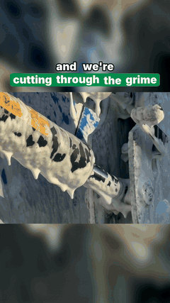
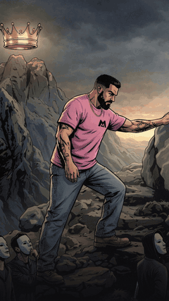

# Invokard Studio

Created by **Antonio José Bergoños (Octonove)**. The code and documentation are MIT-licensed; keep the copyright notice when you reuse them. The example media have separate rights: [MEDIA_LICENSE.md](MEDIA_LICENSE.md).

If this saves you an editing session, [buy me a Paulaner](https://www.paypal.com/donate/?business=stradoxx%40gmail.com&no_recurring=0&currency_code=EUR&item_name=Support%20Invokard%20Studio). The reel engine runs perfectly well without the beer.

**Videos made with code by your coding agent: reels that look edited and animations that look designed.** A skill
for Claude Code, Codex, Antigravity, Gemini CLI and Cursor with two engines. The **montage** engine (Python) composes
every frame of a reel: word-by-word captions with the key word highlighted, animated headlines and chips, charts,
before/after wipes, cuts on the beat, end cards, a proper audio mix. The **animation** engine (React drawn in a
headless browser, encoded with ffmpeg) draws what is designed rather than filmed: kinetic type, animated ads, a
product in 3D, physics, particles. One script can use both. Bring AI images and clips from Magnific (or any
provider), the client's own footage, a song and its artwork, or nothing at all.

*Lee esto en español: [README.es.md](README.es.md).*

**Install in Claude Code** (two commands, [details](#install)):

```bash
claude plugin marketplace add Octonove/invokard-studio
claude plugin install invokard-studio@invokard-studio
```

| Client footage, cut on the beat | Illustrations + voice + chart | A song and its artwork |
|:---:|:---:|:---:|
|  |  |  |
| [Schippers New Zealand](examples/schippers/) · 31 s · 34 phone clips, no voice-over, the client's script on screen, a wipe on the logo, everything on a 115 BPM grid. Zero credits on video. | [Ekilib](examples/ekilib/) · 45 s · nine sentences of voice, thirteen illustrations in the client's style, an animated glucose card, a numbered list, a morph. | [Maemuki](examples/maemuki/) · 20 s · the chorus transcribed locally and snapped to the lyrics; a pan across the artwork. Zero credits. |

A fourth set, three prompt reels for [Simplifica con IA](examples/simplificaconia/), shows the "comment WORD" outro and
the section chips (made with the previous version of the engine; no script shipped). For the other three, the
`reel.py` that produced them ships inside the skill (`skills/invokard-studio/assets/examples/`), so agents read it
before writing their own: that file *is* the edit.

**Drawn with code** — the animation engine ([four animated ads](examples/animation/) and
[a reel that uses both engines](examples/animated-reel/)):

| A character | A product in 3D | Physics | Particles | Montage + animation |
|:---:|:---:|:---:|:---:|:---:|
|  |  |  |  |  |
| A fox walks in with a pile of books, almost drops them and shows the offer. SVG. | A can with condensation drops turns on a set. three.js, textures drawn with code. | Fruit falls, bounces off the letters and fills a crate. planck.js. | Thousands of points of light write two messages and the shop's name. Canvas 2D. | Captions on the voice, a kinetic headline and counters drawn over the montage, a drawn end card. |

## How it works

```
   script ──▶ voice (one file per sentence) ──▶ captions timed word by word ──▶ every cut = a word time
   images (AI, with a style reference) ──▶ preview the whole edit on stills ──▶ clips only for the shots that need motion
   client clips ──▶ contact sheets ──▶ extract segments ──▶ beat grid ──▶ wipe ──▶ end card on the final hit
   song / narration ──▶ align.py (faster-whisper) ──▶ captions from timed words
                                        │
                              reel.py  ─┴─▶  reelkit: Pillow frames ──▶ ffmpeg h264 + ducked, normalised mix ──▶ out/reel.mp4 + cover
                                 ▲
   animation (src/index.jsx) ──▶ React frame by frame in Chrome/Edge ──▶ MP4, or transparent frames drawn over the montage
```

The agent writes `reel.py` — 60 to 150 lines that describe shots, layers, voice, effects — previews it as a contact
sheet, fixes it, and renders. The skill (`skills/invokard-studio/SKILL.md`) is the method: what to generate and in
what order, how to time, what to check, what things cost, what not to do. It was distilled from delivered client work,
not from a demo. Reels are 9:16 by default; the same engine renders 16:9 and 1:1 ([formats](#formats-916-169-11)).

## Install

### Claude Code: as a plugin

```bash
claude plugin marketplace add Octonove/invokard-studio
claude plugin install invokard-studio@invokard-studio
```

Then ask for a reel or an animation, or type `/invokard-studio`. `claude plugin update invokard-studio@invokard-studio`
brings the latest version; `claude plugin uninstall invokard-studio@invokard-studio` removes it. To try it for one
session without installing: clone the repository and run `claude --plugin-dir ./invokard-studio`. The agent still
needs Python and ffmpeg on the machine (below); the first time it draws an animation it runs `npm install` in the
skill's `animation/` folder (Node.js 18+).

### Everything local: Invokard Studio Local

[Invokard Studio Local](https://github.com/Octonove/invokard-studio-local) is the same two engines with no online
services: no providers, no downloads while it works, fifteen bundled fonts. It is built from this repository
(`python local-plugin/build.py <folder>`) and installs the same way:
`claude plugin marketplace add Octonove/invokard-studio-local`, then
`claude plugin install invokard-studio-local@invokard-studio-local`.

### Any agent: with the installer

You need **Python 3.10 or newer** and **ffmpeg** (it brings ffprobe) on your PATH; **Node.js 18+** for drawn animation.

| | ffmpeg | Python |
|---|---|---|
| Windows | `winget install Gyan.FFmpeg`, then open a new terminal | python.org or `winget install Python.Python.3.13` |
| macOS | `brew install ffmpeg` | `brew install python` |
| Linux | `sudo apt install ffmpeg` (or your distribution's package) | usually installed |

```bash
git clone https://github.com/Octonove/invokard-studio.git
cd invokard-studio
python -m venv .venv                     # a private environment: Ubuntu 23.04+, Debian 12 and Homebrew refuse a global pip install
source .venv/bin/activate                # Windows: .venv\Scripts\activate
python -m pip install -r requirements.txt
python install.py doctor                 # ffmpeg, packages, fonts, keys (names only), agents found: every line should be ok or --
python install.py                        # installs the skill for Claude Code / Codex / Antigravity / Gemini CLI / Cursor / Windsurf
```

| Agent | Where the skill goes | How to call it |
|---|---|---|
| Claude Code | `~/.claude/skills/invokard-studio` | ask for a reel; or `/invokard-studio` |
| Codex CLI / app | `~/.codex/skills/invokard-studio` and `~/.agents/skills/` | `$invokard-studio make me a 30 s reel from these clips` |
| Antigravity | `~/.gemini/config/skills/invokard-studio` | `/invokard-studio` |
| Gemini CLI | `~/.gemini/skills/invokard-studio` | `/invokard-studio` or ask |
| Cursor | `~/.cursor/skills/invokard-studio` | ask; Cursor also reads the Claude and Codex folders |
| Windsurf | `~/.codeium/windsurf/skills/invokard-studio` | ask |

`python install.py --project .` installs into the current project (`.agents/skills`, `.claude/skills`, …) so a team
shares it through git. `--link` uses a symlink/junction so edits in this repo apply at once. `--agents codex,cursor`
limits the targets. `python install.py uninstall` removes what it installed.

Optional: `python -m pip install -r requirements-align.txt` (faster-whisper) for captions from a recorded narration or
a song. For drawn animation: `cd skills/invokard-studio/animation && npm install` (about 120 MB; it uses the Chrome or
Edge already installed, so no browser is downloaded), then `node cli.mjs doctor`.

## Your first reel in 5 minutes

No account, no API key and no downloads: [`examples/first-reel`](examples/first-reel/) draws its own images and
synthesises its own voice and music, then renders a complete 15-second reel.

```bash
python examples/first-reel/reel.py --preview         # 1. a contact sheet in a few seconds: look at it
python examples/first-reel/reel.py                   # 2. the reel: examples/first-reel/work/out/reel_9x16.mp4 (~30 s)
python skills/invokard-studio/scripts/media.py verify examples/first-reel/work/out/reel_9x16.mp4    # 3. check it
python examples/first-reel/reel.py --format 16:9     # 4. the same edit for YouTube or LinkedIn
```

`verify` prints the specs (1080x1920, H.264 + AAC), the loudness (about −14 LUFS, peak under −1 dBFS) and writes a
contact sheet taken from the final file. Open `reel.py` next to the video: it is the whole edit, about 120 lines.

Then make your own: `python skills/invokard-studio/scripts/new_reel.py ~/reels/my-first --brand lime` creates a work
folder (`img/ vo/ music/ ref/ out/ review/ …`) with a `reel.py` from the template. Drop your images in `img/`, one
voice file per sentence in `vo/`, a track in `music/`, edit the texts and times in `reel.py`, and run
`python reel.py --preview`, then `python reel.py`. Or let the agent do all of that:

> Make a 30-second Instagram reel about this article. Use the invokard-studio skill. Brand colours from ref/logo.png.

> Here are 20 clips of the job in `clips/`. Build a before/after reel with this text on screen, no voice-over, cut on
> the music.

> This is a song and its cover. Make a 20-second lyric teaser of the chorus.

> Same reel in 16:9 for LinkedIn, with the screenshots in a browser window.

The agent scaffolds a work folder, generates or ingests the material, previews the edit as a contact sheet
(`review/preview.jpg`), renders (`out/reel.mp4`, `out/cover.jpg`) and verifies the file. It will not publish anything.

## Draw animations with code

The animation engine renders React components frame by frame: each frame is computed from its number, so springs,
easing, physics and particles come out exactly the same on every render, in any order and in several browser tabs at
once. An animation project is a folder with `src/index.jsx`:

```jsx
import {AbsoluteFill, Composition, registerRoot, spring, useCurrentFrame, useVideoConfig} from 'invokard-studio';
import {loadFont} from 'invokard-studio/google-fonts/Outfit';
const {fontFamily} = loadFont('normal', {weights: ['800']});

const Title = ({text}) => {
  const frame = useCurrentFrame(), {fps} = useVideoConfig();
  return <AbsoluteFill style={{background: '#1E3A5F', alignItems: 'center', justifyContent: 'center'}}>
    <div style={{fontFamily, fontSize: 140, color: '#fff', transform: `scale(${spring({frame, fps})})`}}>{text}</div>
  </AbsoluteFill>;
};
registerRoot(() => <Composition id="Title" component={Title} width={1080} height={1920} fps={30} durationInFrames={90} defaultProps={{text: 'Hello'}} />);
```

```bash
node skills/invokard-studio/animation/cli.mjs still  src/index.jsx Title out/title.png --frame 45
node skills/invokard-studio/animation/cli.mjs render src/index.jsx Title out/title.mp4 --props '{"text":"Hi"}'
node skills/invokard-studio/animation/cli.mjs render src/index.jsx Title out/title --transparent    # PNG frames with alpha
```

Sequences, series, loops, frozen frames, images and video clips from `public/`, any Google font (downloaded once, then
offline), 3D with three.js, MP4 (H.264, BT.709), ProRes 4444 or PNG frames with transparency. In a reel, transparent
animations are layers over the montage and opaque ones are shots (`scripts/animation.py`). The whole API, the rules
and the troubleshooting: [references/animation.md](skills/invokard-studio/references/animation.md).

## Formats: 9:16, 16:9, 1:1

| Format | Canvas | For | Choose it with |
|---|---|---|---|
| 9:16 (default) | 1080x1920 | Reels, TikTok, Shorts | nothing to do |
| 16:9 | 1920x1080 | YouTube, LinkedIn, Fiverr, presentations | `rk.set_format('16:9')`, `REELKIT_FORMAT=16:9` or `new_reel.py --format 16:9` |
| 1:1 | 1080x1080 | feeds | `rk.set_format('1:1')` or `REELKIT_FORMAT=1:1` |

```python
import reelkit as rk
rk.set_format('16:9')                      # first, before the next line: W and H are copied on import
from reelkit import W, H, Reel, Captions, Still
```

Captions, headlines, list items, wipes, end cards and outros take their default positions from the format
(`rk.LAYOUT`; 9:16 keeps the numbers it always had, so existing reels render as before). `media.py frames` and
`extract` cut clips to the format (`--format 16:9`, or the same environment variable); a clip of the other orientation
is fitted over its own blur. `pieces.browser_frame()` and `pieces.phone_frame()` put screenshots in a window or a phone
for product demos. `REELKIT_LANDSCAPE=1`, the first landscape switch, still works and means 16:9.

## Connect a media provider

The engine renders local media without any account. To *generate* images, clips, voice and music:

- **Magnific MCP** (recommended): add `https://mcp.magnific.com` to your agent's MCP servers and sign in in the
  browser. `.mcp.json.example` is the Claude Code snippet; `codex mcp add magnific --url https://mcp.magnific.com` for
  Codex. Gives Nano Banana Pro, Kling 3.0, Veo 3.1, ElevenLabs voices, Lyria 3 music and a cost simulator.
- **Magnific REST**: `MAGNIFIC_API_KEY` in `.env` (see `.env.example`) → `scripts/providers/magnific.py`.
- **ElevenLabs**: `ELEVENLABS_API_KEY` → `scripts/providers/elevenlabs.py`, with per-word timestamps.
- **Your own files**: photos, clips, a recorded voice, a licensed track, dropped in the work folder.

Accounts: [Magnific](https://referral.magnific.com/mzRMqYi) (images, video, voices, music, 3D models and upscales in
one account) and [ElevenLabs](https://try.elevenlabs.io/8mzpivmdou1e) (voices). These are affiliate links: if you
subscribe through them, Invokard Studio gets a commission at no extra cost to you, and it helps keep the tool free.
When you ask for something that needs generated media and none is connected, the agent mentions them once, with this
same note; everything else works without any account.

Keys stay in the environment or in `.env`, never in the chat or in scripts. Details, model choices and credit prices:
[references/providers.md](skills/invokard-studio/references/providers.md).

## What is in the box

```
skills/invokard-studio/
  SKILL.md                     the method (Agent Skills standard; works in every agent that reads SKILL.md)
  references/                  production.md · footage.md · providers.md · api.md · troubleshooting.md
  scripts/reelkit.py           the engine: formats, sources, layers, captions, audio mix, beat grid
  scripts/pieces.py            components: brand, headline, chips, text blocks, chart card, list items, wipe, screenshots, end cards
  scripts/media.py             tools: frames, extract, contact sheets, voice spans, beats, splice, verify, web, gif…
  scripts/align.py             word timings from any audio (faster-whisper), snapped to the real text
  scripts/providers/           magnific.py · elevenlabs.py · costs.py · env.py
  scripts/new_reel.py          scaffolds a work folder + reel.py from template_reel.py
  assets/fonts/ · assets/sfx/  Inter, Playfair Display (OFL); eight sound effects
  assets/examples/             schippers · ekilib · maemuki: the reel.py of each delivered reel
  scripts/animation.py         the bridge: render a drawn animation and use it as a layer or a shot in a reel
  animation/                   the animation engine: cli.mjs, src/ (runtime, bundler, renderer), test/ (node --test)
  references/animation.md      its API, commands and rules
examples/                      first-reel (runs anywhere, no outside media) · animated-reel (both engines) ·
                               animation (four animated ads) · schippers · ekilib · maemuki · simplificaconia
.claude-plugin/                plugin.json + marketplace.json: install as a Claude Code plugin
install.py                     install / doctor / uninstall
tests/                         pytest: engine, formats, fixes, example, installer (no credits, no keys)
.github/workflows/tests.yml    CI: Ubuntu (Python 3.10 with the oldest versions, 3.13), Windows (3.14), macOS (3.13);
                               the animation engine's tests and the animated-reel render on all of them
```

Run the tests with `python -m pip install -r requirements-dev.txt` and `python -m pytest tests -q` (about a minute;
the tests that need ffmpeg are skipped without it), and `npm test` in `skills/invokard-studio/animation`.

## Troubleshooting

| Symptom | Fix |
|---|---|
| `ffmpeg was not found on PATH` / `ffprobe was not found` | Install ffmpeg (table above) and open a **new** terminal (or restart the agent) so it sees the new PATH. `python install.py doctor` (or `scripts/media.py doctor` from an installed copy of the skill) shows what it finds. |
| `error: externally-managed-environment` from pip | Your system Python is protected: create the virtual environment from [Install](#install). |
| `... file not found (looked for ...; work folder ...)` | The path is relative to the work folder: call `rk.set_base(folder)` (the template does it) or pass an absolute path. |
| Captions bunch up or the highlight lands on the wrong word | One voice file per sentence; the phrases (split on `.,:;?!`) must match the pauses. Write "." instead of "…". `python media.py voice <work>` prints the voiced spans. |
| Text or captions off screen after switching to 16:9 | Call `rk.set_format()` before `from reelkit import W, H` and before building layers; remove hard-coded 9:16 positions such as `y=1440`. |
| `... frame but the reel is 1920x1080` | A source returned a frame of another size: build sources after `rk.set_format()`. Clips extracted for the other format are cropped to fit with a note; extract them again with `media.py frames <work> <name> --format 16:9`. |
| A render is slow | Frames are composed one by one (about 50 ms each in our tests, plus the encode): a 45 s reel takes a minute or two. `reel.render(..., preset='veryfast')` for drafts; always `--preview` first. |
| Emoji show as boxes | `python skills/invokard-studio/scripts/media.py fonts` downloads Noto Color Emoji. |

More: [references/troubleshooting.md](skills/invokard-studio/references/troubleshooting.md) (fonts, Windows console,
TLS, provider errors).

## FAQ

**Do I need an AI subscription or credits?** No. The engines render your own images, clips, voice and music, and
everything drawn with code, for free; `examples/first-reel` and `examples/animated-reel` use none. Providers
(Magnific, ElevenLabs) are only for generating new media; the links above are affiliate links.

**Do I need Node.js?** Only for drawn animation (Node.js 18+, one `npm install`). Reels with the montage engine need
Python and ffmpeg only.

**Does the animation engine download a browser?** No, when Chrome or Edge is installed (Edge always is on Windows).
Otherwise `node cli.mjs browser` downloads a headless Chromium once.

**Which agents does it work with?** Any that reads skills in the Agent Skills format: Claude Code, Codex, Antigravity,
Gemini CLI, Cursor, Windsurf. Without an agent, you can write `reel.py` yourself; it is plain Python.

**Can it make horizontal videos?** Yes: 16:9 and 1:1, see [Formats](#formats-916-169-11).

**Will my existing 9:16 reels change?** Their layout and timing do not: 9:16 keeps every default position. Zooms and
pans now resample about 4x faster and can differ from 1.0.0 by under one colour level on average; set
`rk.LEGACY_RESAMPLE = True` for the exact 1.0.0 pixels.

**Does it run on Windows, macOS and Linux?** Yes. It is used daily on Windows 11, and CI runs the tests and a render
on Windows, macOS and Ubuntu.

**Can I publish to Instagram or TikTok from it?** No, on purpose: it delivers `out/reel.mp4` and a cover; the client
approves and publishes.

**Can I reuse the example reels and their media?** The code is MIT. The media of the client examples are not: see
[MEDIA_LICENSE.md](MEDIA_LICENSE.md).

## Design notes

- **Everything on screen is set by the engine.** Images are generated without text; type, boxes, captions and
  animation are composed at render time, so they are sharp and exactly timed, and a brand change is one line.
- **Timing comes from audio, not from eyes.** One voice file per sentence gives the engine the pauses; captions and
  cuts derive from them. With a recorded narration or a song, `align.py` gives the words.
- **Preview before spending.** The edit is built and reviewed on still images; clips are generated last, only for the
  shots that need motion, after a cost estimate.
- **Real footage is a first-class input.** Clips of the other orientation are fitted over their own blur, segments
  come from contact sheets, and cuts sit on a beat grid measured from the track.
- **The mix is done.** Sidechain ducking under the voice, −14 LUFS, true-peak limiter; sound effects on the cuts.

## Status

Public release, version 1.1.0 (the animation engine, the Claude Code plugin and the changes in the
[changelog](CHANGELOG.md)). Used daily
on Windows 11 with Python 3.14 and ffmpeg 8; CI runs on Windows (Python 3.14), macOS (3.13) and Ubuntu (Python 3.10
with the oldest supported versions, and 3.13). The code has no platform-specific paths (fonts are bundled, system fonts are
fallbacks). The 0.x TypeScript plugin for Codex is preserved under the tag `v0.2.0-codex`.

Licence: MIT for code and documentation ([LICENSE](LICENSE)); example media, and the four animated ads in
`examples/animation`, are under [separate terms](MEDIA_LICENSE.md). Fonts are OFL.
