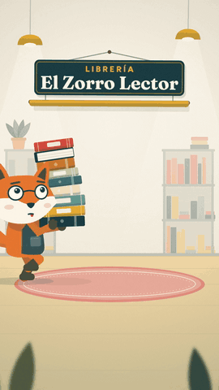
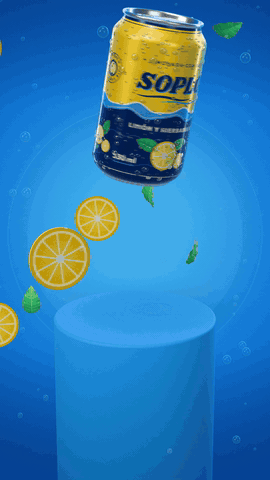
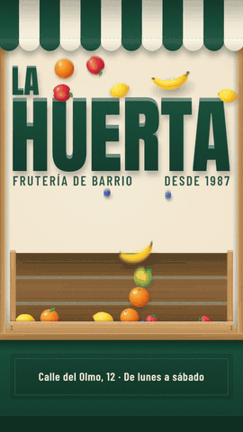
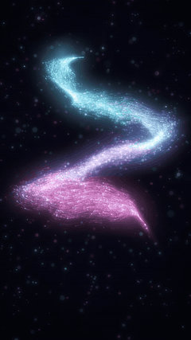

# Animated ads drawn with code

Four of the ten ads of the [Simplifica con IA ad kit](https://simplificaconia.com/anuncios-animados-con-ia/), rendered
by Invokard Studio's animation engine. Each one is a React component that draws a frame from its number; nothing is
filmed or generated by an image model. The business, texts and colours of each ad live in its `datos.js`. The kit is
Spanish, and so are its comments and sample texts.

| A character | A product in 3D | Physics | Particles |
|:---:|:---:|:---:|:---:|
|  |  |  |  |
| **mascota** · a fox walks in with a pile of books, almost drops them and shows the offer. SVG, a walk cycle and secondary motion. | **producto3d** · a can with its label and condensation drops turns on a set, with lemon slices and leaves. three.js, every texture drawn with code. | **fisica** · fruit falls, bounces off the letters of the sign and fills a crate. planck.js physics, re-simulated for every frame. | **particulas** · thousands of points of light fly like a flock, write two messages and end as the name of the shop. 2D canvas. |

## Render them

```bash
cd skills/invokard-studio/animation && npm install     # once: the engine (from the repository root)
cd examples/animation && npm install                   # once: planck, for the physics
node render.mjs lista                                  # the four ads
node render.mjs mascota foto 120                       # one frame -> out/mascota-f120.png (frame 120 = second 4)
node render.mjs mascota fotos                          # eight frames across the 8 seconds, to check the motion
node render.mjs mascota                                # the video -> out/mascota.mp4 (1080x1920, 30 fps, 8 s)
node render.mjs mascota alt                            # the same ad with the second data set
```

To make one for another business, change the values of `DATOS` in `src/<name>/datos.js` (each field has its limit
next to it) and render again; `NOTAS.md` in each folder says what can change and what the drawing does. To change the
drawing itself (another animal, a bottle instead of a can), copy the folder and edit its components: the timing and
the motion are already tuned. The engine's API is in
[`skills/invokard-studio/references/animation.md`](../../skills/invokard-studio/references/animation.md).

The first render downloads the fonts from Google Fonts into `.invokard/fonts`; later renders work offline.

## Licence

These four ads are **not** covered by the MIT licence of Invokard Studio: see [LICENSE.md](LICENSE.md). You can
study them, render them and adapt them to make ads for yourself or for your clients; you cannot redistribute or sell
them as templates. `render.mjs` and `package.json` are MIT like the rest of the repository.
