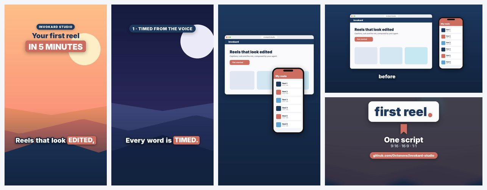

# Your first reel — a complete example with no outside media



A 15-second reel made only from what the script draws and synthesises on its first run: three Pillow illustrations, a
landing-page and an app "screenshot", a wordmark, four "voice" files (one per sentence) and a 120 BPM music bed made
with ffmpeg. Nothing is downloaded and no account is needed, so it is the quickest way to check that your machine can
render, and the shortest complete `reel.py` to copy from.

```bash
python examples/first-reel/reel.py --preview               # contact sheet in a few seconds: work/review/preview_9x16.jpg
python examples/first-reel/reel.py                         # 9:16 -> work/out/reel_9x16.mp4 + cover_9x16.jpg
python examples/first-reel/reel.py --format 16:9           # the same edit for YouTube or LinkedIn (also: 1:1)
python examples/first-reel/reel.py --format 16:9 --fast    # draft encode (x264 veryfast)
python skills/invokard-studio/scripts/media.py verify examples/first-reel/work/out/reel_9x16.mp4
```

On a recent laptop each render takes about half a minute. `verify` should report 1080x1920 (or 1920x1080), H.264 +
AAC, about −14 LUFS and a peak under −1 dBFS.

What it shows, in order:

- **Captions timed from the voice.** The "voice" is a hummed tone with one burst per phrase, so `caps.line()` snaps
  each phrase to its burst exactly as it does with a real voice-over. Record the four sentences yourself, save them over
  `work/vo/v01.wav … v04.wav` and run it again: captions and cuts follow your voice.
- **Cuts from word times.** Every `reel.shot()` boundary is `caps.word_time(...)` or a sentence start, never a number
  picked by eye.
- **A detail without generating anything.** `Still('img/night.png', z=(2.2, 2.4), c0=(.67, .27))` reframes the moon.
- **Screenshots in a browser window and a phone** (`pz.browser_frame`, `pz.phone_frame`), each popping in on its word,
  with positions chosen per format.
- **A before/after wipe**, an end card (`pz.outro_save`), effects on the cuts and music ducked under the voice.
- **One script, three formats.** `rk.set_format()` runs before `from reelkit import W, H`; captions, headline, labels and
  the end card move to the format's default positions (`rk.LAYOUT`).

Everything it writes goes to `work/` (git-ignored). Delete that folder to start again. Every image and sound in it is
drawn or synthesised by the script itself; nothing comes from a third party.
